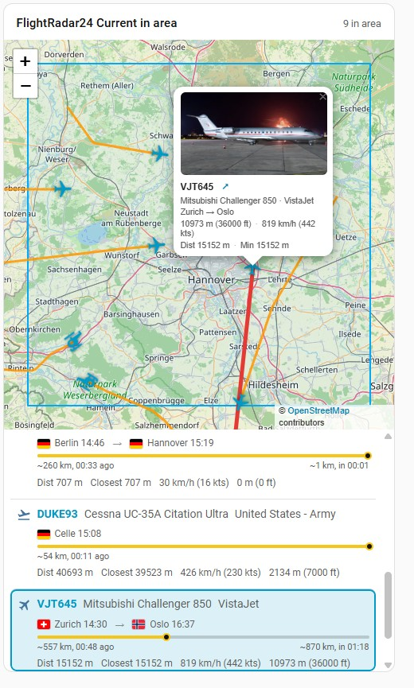
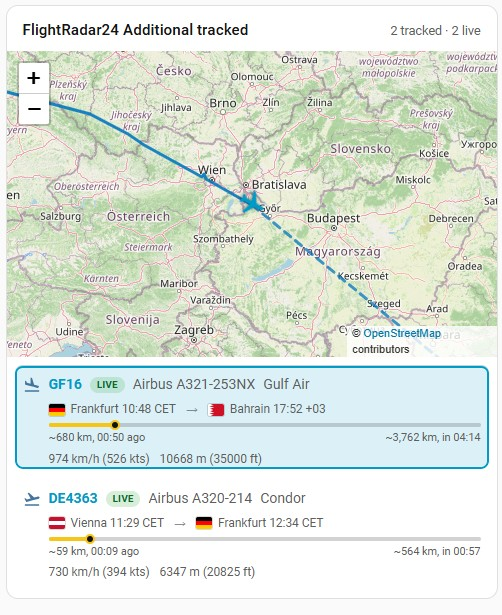

# Changelog

All notable changes to this project are documented in this file.

## [UNRELEASED]

### Changed

- Tracking card hides the map when there are no live flights and shows it again as soon as one becomes active (still defaults to the first live flight)
- Tracking card list sorts live flights first (then aircraft, then scheduled) ([#364](https://github.com/AlexandrErohin/home-assistant-flightradar24/issues/364))
- Tracking card always uses smooth coast/catch-up map motion between sensor updates (`smooth_motion` option removed)
- Tracking card uses `mdi:airplane-clock` for scheduled flights instead of the cruise airplane icon ([#364](https://github.com/AlexandrErohin/home-assistant-flightradar24/issues/364))

### Added

- Airport weather sensors from the existing airport details poll: wind direction (degrees + text), wind speed, temperature, humidity, pressure, dewpoint, sky condition, and visibility; integration options set temperature / distance / speed units ([#338](https://github.com/AlexandrErohin/home-assistant-flightradar24/discussions/338))
- Flight details expose `airport_origin_gate` / `airport_destination_gate` and `airport_origin_baggage` / `airport_destination_baggage` when FR24 publishes them; airport arrivals/departures add local `terminal` / `gate` / `baggage` plus remote `airport_terminal` / `airport_gate` / `airport_baggage` ([#343](https://github.com/AlexandrErohin/home-assistant-flightradar24/issues/343))
- Map and Tracking cards: `theme_mode` (`auto` / `light` / `dark`) darkens OpenStreetMap and topographic basemap tiles to match Home Assistant dark themes without an API key ([#366](https://github.com/AlexandrErohin/home-assistant-flightradar24/issues/366))
- Tracking card: `zoom_mode: fit_route` auto-zooms to fit origin and destination airports (plus the aircraft); `follow` keeps the previous aircraft-centred fixed zoom ([#363](https://github.com/AlexandrErohin/home-assistant-flightradar24/issues/363))
- Map and Tracking cards: `show_map` toggle and `detail_level` (`full` cities / `compact` IATA); registration shown next to the aircraft model when known ([#364](https://github.com/AlexandrErohin/home-assistant-flightradar24/issues/364))

### Fixed

- Tracked flights found by FR24 search (Add to track / post-landing refresh) keep the exact trail position instead of the search answer rounded to 0.1°, so the marker and track no longer jump several km ([#151](https://github.com/AlexandrErohin/home-assistant-flightradar24/issues/151), [#361](https://github.com/AlexandrErohin/home-assistant-flightradar24/pull/361))
- Airport text input shows the airport that is actually tracked: a rejected or unknown code is not kept in the entity (or restored after restart), so refresh no longer retries it every 90 s ([#362](https://github.com/AlexandrErohin/home-assistant-flightradar24/pull/362))
- Tracking (and map) card Flightradar24 links for scheduled flights use `/data/flights/{number}` instead of a live callsign/id URL that 404s ([#364](https://github.com/AlexandrErohin/home-assistant-flightradar24/issues/364))

## [2.6.0] - 2026-11-18

### Added

- New Lovelace card `flightradar24-tracking-card` for `sensor.flightradar24_additional_tracked`: follows a live aircraft (centred, north up), smooth coast/catch-up motion between sensor updates, live vs scheduled list, optional origin→track→destination route, and FR24-style progress bar (`~km` flown / remaining with elapsed and ETA clocks)
- Map card (`flightradar24-card`) flight list now includes the same FR24-style progress bar (`~km` flown / remaining with elapsed and ETA clocks)

### Fixed

- Adding an airborne flight while `get_flight_details` is rate limited no longer fails with "No flight found"; the search hit is kept as a live stub (without REG) until details succeed, without a false `left_gate` ([#357](https://github.com/AlexandrErohin/home-assistant-flightradar24/issues/357), [#359](https://github.com/AlexandrErohin/home-assistant-flightradar24/pull/359))
- False `arrived_gate` during post-landing taxi ADS-B gaps (then a spurious `left_gate`) — gate arrival now requires a sustained feed absence, longer while ground speed still looks like taxiing ([#317](https://github.com/AlexandrErohin/home-assistant-flightradar24/issues/317))
- Airport details refresh at most every 90 s (immediate on set), curl timeouts are not retried, and a hanging `airport.json` no longer delays the area/tracked notify path ([#347](https://github.com/AlexandrErohin/home-assistant-flightradar24/issues/347), [#360](https://github.com/AlexandrErohin/home-assistant-flightradar24/pull/360))

> **Important:** After updating the integration, **reload the Flightradar24 integration** (or restart Home Assistant), then **hard-refresh the browser** (or clear the frontend cache) so Lovelace loads the new `flightradar24-tracking-card.js` module. Without a page refresh the UI may keep the previous frontend bundle and the Tracking Card will not appear in **Add Card**.

<table>
  <tr>
    <td width="50%" valign="top">
      
    </td>
    <td width="50%" valign="top">
      
    </td>
  </tr>
</table>

## [2.5.0] - 2026-11-11

### Added

- Map card option `clear_selection_on_popup_close` (default `true`) to clear the selected aircraft and its track when the details popup is closed; set to `false` to keep the previous persistent selection ([#349](https://github.com/AlexandrErohin/home-assistant-flightradar24/issues/349))

### Fixed

- Flight-number / callsign tracking no longer follows the airframe onto the next sector when the live feed omits number/callsign and flight details are unavailable (e.g. SQ237 → SQ106 on the same REG during a details cooldown) ([#317](https://github.com/AlexandrErohin/home-assistant-flightradar24/issues/317))

## [2.4.2] - 2026-10-30

### Fixed

- False `flightradar24_tracked_left_gate` / `flightradar24_tracked_arrived_gate` after a real arrival when the same flight briefly reappears in the live feed (parked ADS-B); arrival completion flags are kept on the aircraft stub, `left_gate` is blocked until a new segment, and after `left_gate` a sticky `time_real_arrival` is ignored until the segment is airborne again ([#276](https://github.com/AlexandrErohin/home-assistant-flightradar24/issues/276))
- Missing `flightradar24_tracked_landed` when the live feed drops the aircraft before `on_ground` 0→1 is polled; arrival evidence now also emits `landed` once before `arrived_gate` ([#276](https://github.com/AlexandrErohin/home-assistant-flightradar24/issues/276))
- Additional tracked entries by flight number/callsign no longer follow the aircraft registration onto the next sector (e.g. SQ306 → SQ305, QF2051 → QF2052); airframe-only tracking is unchanged ([#317](https://github.com/AlexandrErohin/home-assistant-flightradar24/issues/317))

## [2.4.1] - 2026-10-29

### Fixed

- Tracked flights refresh their details every few minutes, so the estimated arrival no longer stays at its take-off value for the whole flight [#351](https://github.com/AlexandrErohin/home-assistant-flightradar24/pull/351)
- Fixed "cannot import name 'RestoreEntity' from 'homeassistant.components.text'" for Home Assistant 2026.11 [#348](https://github.com/AlexandrErohin/home-assistant-flightradar24/pull/348)

## [2.4.0] - 2026-10-21

### Added

- Map card option `show_area` to hide the monitored area outline and tint; default remains visible ([#336](https://github.com/AlexandrErohin/home-assistant-flightradar24/issues/336), [#339](https://github.com/AlexandrErohin/home-assistant-flightradar24/pull/339))
- Map card options `altitude_unit`, `distance_unit`, and `speed_unit` for independent display units in the flight list and popups ([#326](https://github.com/AlexandrErohin/home-assistant-flightradar24/issues/326), [#337](https://github.com/AlexandrErohin/home-assistant-flightradar24/pull/337))
- Map card shows a helicopter icon in the flight list and on the map when `aircraft_category` is `Helicopter` ([#340](https://github.com/AlexandrErohin/home-assistant-flightradar24/issues/340))
- Local brand assets under `custom_components/flightradar24/brand/` for Home Assistant 2026.3+ ([#344](https://github.com/AlexandrErohin/home-assistant-flightradar24/pull/344))

### Fixed

- Coordinator publishes flight data once per poll (no intermediate `async_set_updated_data`); prefetch most-tracked/airport at setup; first refresh only area+tracked; device tracker skips identical writes — stops ~8 duplicate recorder rows per cycle ([#320](https://github.com/AlexandrErohin/home-assistant-flightradar24/issues/320), [#325](https://github.com/AlexandrErohin/home-assistant-flightradar24/pull/325))
- Map card calls `invalidateSize` when its container resizes (e.g. sections `column_span`), so tiles fill the full width without needing a manual zoom ([#327](https://github.com/AlexandrErohin/home-assistant-flightradar24/issues/327), [#334](https://github.com/AlexandrErohin/home-assistant-flightradar24/pull/334))
- HTTP 429 storms after v2.1.2: disable FlightRadarAPI empty-feed rerolls (`FEED_EMPTY_RETRIES=0`), do not retry 429, and pause the affected endpoint with exponential back-off up to 15 minutes (honours `Retry-After` when present) ([#254](https://github.com/AlexandrErohin/home-assistant-flightradar24/issues/254), [#330](https://github.com/AlexandrErohin/home-assistant-flightradar24/issues/330), [#332](https://github.com/AlexandrErohin/home-assistant-flightradar24/issues/332), [#333](https://github.com/AlexandrErohin/home-assistant-flightradar24/pull/333), [#341](https://github.com/AlexandrErohin/home-assistant-flightradar24/pull/341))
- Tracked flights keep updating when the area feed fails or is rate-limited ([#341](https://github.com/AlexandrErohin/home-assistant-flightradar24/pull/341))
- Setup continues with an unverified session on canary HTTP 429 instead of leaving every entity unavailable; login 429 becomes `ConfigEntryNotReady` so Home Assistant retries, while 401/403 stay auth failures ([#301](https://github.com/AlexandrErohin/home-assistant-flightradar24/issues/301), [#328](https://github.com/AlexandrErohin/home-assistant-flightradar24/pull/328))
- Fetch `get_flight_details` for every flight that needs it until the details endpoint is paused (429 or other failure; pause lasts across cycles until cooldown expires); new flights without successful details are not published as feed-only stubs; share request spacing process-wide so multiple entries are less likely to re-trigger IP limits ([#341](https://github.com/AlexandrErohin/home-assistant-flightradar24/pull/341))

## [2.3.0] - 2026-10-06

### Added

- Map card option `map_style` to switch basemap without an API key: `osm` (default), `satellite` (Esri), `topo` (OpenTopoMap)
- Map card option `interactive_map` for opt-in mouse/touch dragging and pinch zoom, with fixed Close details and Reset view controls; default static dashboards are unchanged ([#324](https://github.com/AlexandrErohin/home-assistant-flightradar24/pull/324))

### Fixed

- Adding or removing a tracked flight updates `Additional tracked` and clears the Add/Remove text inputs immediately, instead of waiting for the next poll ([#318](https://github.com/AlexandrErohin/home-assistant-flightradar24/issues/318), [#323](https://github.com/AlexandrErohin/home-assistant-flightradar24/pull/323))

## [2.2.2] - 2026-10-02

### Fixed

- `scan_interval` of `0` or negative no longer schedules back-to-back API polls; setup and options require at least 10 seconds, and existing entries below the minimum are rewritten once to the 20-second default ([#319](https://github.com/AlexandrErohin/home-assistant-flightradar24/issues/319), [#321](https://github.com/AlexandrErohin/home-assistant-flightradar24/pull/321))
- Options form prefills a valid scan interval when a stored value is below the minimum, so Configure can be saved without first clearing a bad field
- `airport_origin_code_iata` on tracked/most-tracked flight data now uses the IATA code instead of the full airport name ([#322](https://github.com/AlexandrErohin/home-assistant-flightradar24/pull/322))

## [2.2.1] - 2026-09-22

### Fixed

- False `flightradar24_tracked_arrived_gate` events when a tracked flight briefly disappears from the live feed mid-air (ADS-B gaps) or during pre-departure taxi; arrival now requires landing evidence (`has_landed` / `time_real_arrival`) ([#315](https://github.com/AlexandrErohin/home-assistant-flightradar24/issues/315))
- False `flightradar24_tracked_left_gate` events on live-feed reappearances; the event fires only on a real `schedule`/`aircraft` → `live` transition, and gate lifecycle flags reset for the next segment

## [2.2.0] - 2026-09-08

### Added

- Map card option `show_header` to hide the title/count bar above the map (combine with `show_flights: false` for a map-only card)

### Changed

- Reverted dependency `pycountry` from `26.2.16` (introduced in 2.1.2) back to `24.6.1` to match Home Assistant core (e.g. `radio_browser`), fixing the install conflict with HA 2026.9.0 ([#313](https://github.com/AlexandrErohin/home-assistant-flightradar24/issues/313))

### Fixed

- Stop re-fetching flight details every scan for aircraft without a `flight_number` (common for GA/private); recent details now count as valid for the 2–6 minute window, reducing HTTP 429 near airports ([#254](https://github.com/AlexandrErohin/home-assistant-flightradar24/issues/254))

## [2.1.2] - 2026-09-02

### Changed

- Fixed Entity IDs are always English regardless of Home Assistant language; UI names stay translated ([#265](https://github.com/AlexandrErohin/home-assistant-flightradar24/issues/265)) Home Assistant does not rename existing entities. To get English IDs: rename them manually under **Settings → Devices & Services → Entities**, or remove and re-add the integration
- Updated dependency `FlightRadarAPI` from `1.5.1` to `1.6.1`
- Updated dependency `pycountry` from `24.6.1` to `26.2.16`

## [2.1.1] - 2026-08-25

### Break change

- Removed the custom `last_updated` attribute from sensors / most-tracked switch. Templates or automations that read `state_attr(..., 'last_updated')` need to use Home Assistant’s built-in `last_updated` / `last_changed` instead.

### Fixed

- Recorder no longer grows on every poll when area counts stay unchanged (e.g. `0`) — state is written only when the value or recorded attributes actually change ([#308](https://github.com/AlexandrErohin/home-assistant-flightradar24/issues/308), [#312](https://github.com/AlexandrErohin/home-assistant-flightradar24/issues/312))
- Map card flight list no longer rebuilds via `innerHTML` on each update — flags and rows update in place, fixing flag flicker ([#306](https://github.com/AlexandrErohin/home-assistant-flightradar24/issues/306))
- Map card popup text is readable again on dark / glass themes (forced light popup surface) ([#310](https://github.com/AlexandrErohin/home-assistant-flightradar24/issues/310))
- Session recreate pauses between attempts and keeps the current session if login fails, reducing HTTP 429 during bot-mitigation recovery ([#254](https://github.com/AlexandrErohin/home-assistant-flightradar24/issues/254))
